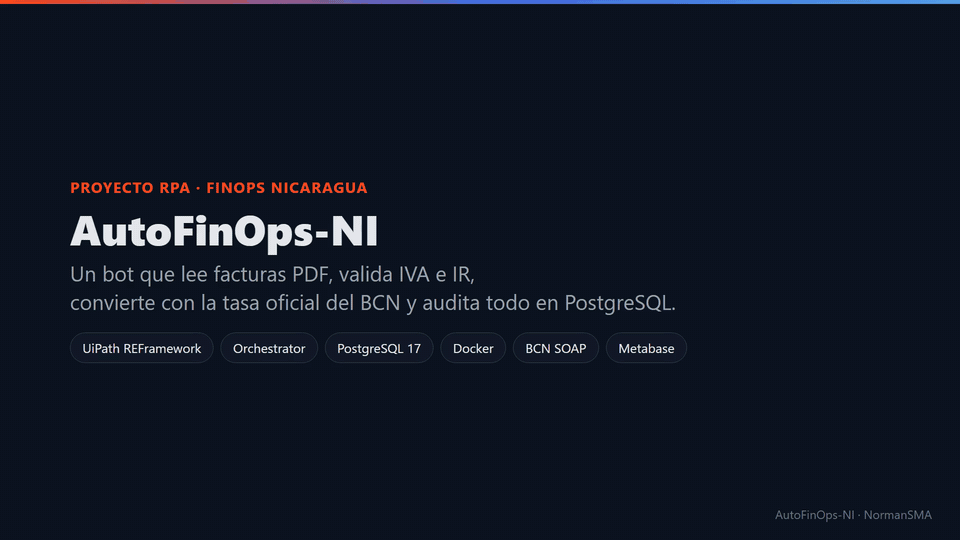
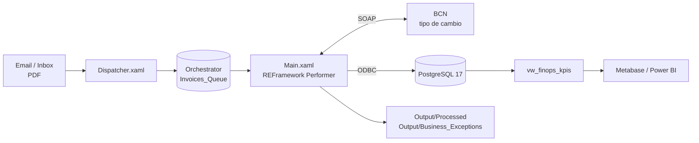
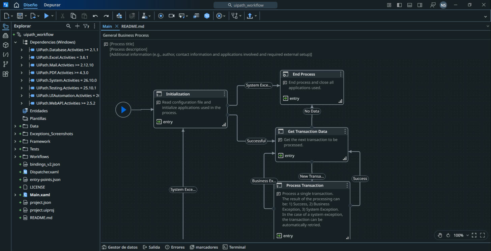
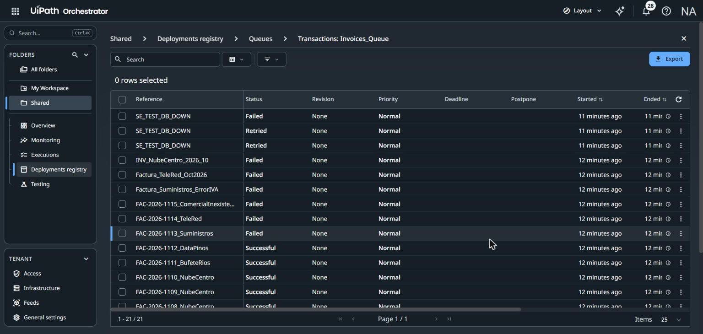
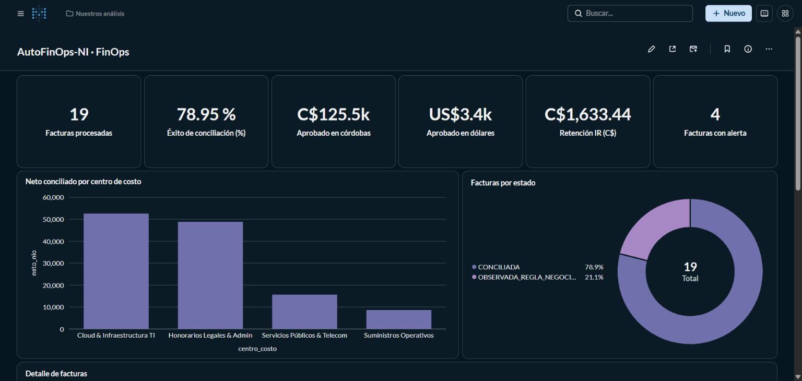

<div align="center">

# AutoFinOps-NI

**Bot RPA que concilia facturas PDF, valida IVA/IR de Nicaragua y audita todo en PostgreSQL.**
*RPA bot that reconciles PDF invoices, validates Nicaraguan VAT/IR and audits everything in PostgreSQL.*


<br/>


<br/><br/>


> Datos de demostración: RUC, proveedores y montos son **ficticios**. · *Demo data: tax IDs, vendors and amounts are **fictitious**.*

</div>

<div align="center">



[Video MP4 (38 s)](docs/demo/autofinops-demo.mp4)

</div>

---

## El problema · The problem

| Manual (As-Is) | Con el bot (To-Be) |
|:---:|:---:|
| ~4.5 min por factura | **~1.7 s** por factura (medido) |
| Tasa BCN buscada a mano | Tasa oficial vía **SOAP `RecuperaTC_Dia`** |
| IVA / IR con calculadora | Reglas **RF-05** automáticas |
| Duplicados por memoria | `UNIQUE (ruc, factura)` en PostgreSQL |
| Sin trazabilidad | Bitácora **`rpa_audit_logs`** por intento |

## Arquitectura · Architecture



Detalle: [docs/architecture.md](docs/architecture.md)

## Qué hace el Performer · What each transaction does

```text
PDF ─► Extract_Invoice_PDF ─► Get_BCN_ExchangeRate ─► Validate_Tax_Rules ─► Insert_PostgreSQL ─► mover PDF
        Read PDF + Regex        SOAP 36.6243           IVA 15% · IR 2%        factura + auditoría
```

| Código | Excepción | Acción |
|---|---|---|
| **BRE-01** | RUC fuera del catálogo | Observada · revisión humana |
| **BRE-02** | IVA ≠ 15% del subtotal | Observada · revisión humana |
| **BRE-03** | Factura duplicada | Rechazada · no se inserta |
| **BRE-04** | PDF sin campos de factura | Excepción de negocio |
| **SE** | BCN o PostgreSQL caídos | Reintento automático ×2 (cola) |

## Resultados reales · Real run (18 PDFs)

<div align="center">

| Conciliadas | Observadas | Duplicadas | Errores de sistema |
|:---:|:---:|:---:|:---:|
| **12** | **3** | **3** | **0** |

</div>

| KPI (`vw_finops_kpis`) | Valor |
|---|---|
| Facturas procesadas | 19 |
| Éxito de conciliación | 78.95 % |
| Aprobado C$ / US$ | 125,518.46 / 3,427.21 |
| Retención IR | C$ 1,633.44 |

| UiPath Studio · REFramework | Orchestrator · Invoices_Queue |
|:---:|:---:|
|  |  |

<div align="center">
<br/>
<sub>Tablero Metabase conectado a <code>vw_finops_kpis</code></sub>
</div>

Pruebas completas: [docs/pruebas-aceptacion.md](docs/pruebas-aceptacion.md)

## Cómo levantar · Quick start

```powershell
# 1. Infraestructura
Copy-Item .env.example infra/.env        # reemplaza los placeholders
docker compose -f infra/docker-compose.yml up -d

# 2. Correos de prueba: 18 facturas + 1 boletín al buzón GreenMail
powershell -File scripts\enviar_facturas_correo.ps1

# 3. Bot (Orchestrator: cola Invoices_Queue y Assets PG_Credential + Mail_Credential en Shared)
cd uipath_workflow
uip rpa run --file-path Dispatcher.xaml --project-dir .
uip rpa run --file-path Main.xaml --project-dir .

# 4. KPIs
docker exec autofinops_postgres psql -U <usuario> -d autofinops_db -c "SELECT * FROM vw_finops_kpis;"
```

| Servicio | URL |
|---|---|
| pgAdmin 4 | http://localhost:5050 |
| Metabase | http://localhost:3001 |
| Buzón IMAP de prueba (GreenMail) | `127.0.0.1:3143` · SMTP `3025` |

Sin correo: pon `MailEnabled: false` en `Data/Config.json` y copia los PDFs a `uipath_workflow\Data\Input\Inbox\`.

Requisitos: Docker, UiPath Studio 26.10, driver **psqlODBC** con DSN `AutoFinOps_PG`. Guía paso a paso: [docs/guia-uipath-reframework.md](docs/guia-uipath-reframework.md)

## Estructura · Layout

```text
├── infra/              docker-compose.yml · init.sql (esquema, seed, vista KPIs)
├── uipath_workflow/    Main.xaml · Dispatcher.xaml · Framework/ · Workflows/ · Data/Config.json
├── sample_invoices/    18 facturas PDF de prueba
├── scripts/            generadores de PDFs (GenOffice CLI)
└── docs/               PDD · arquitectura · guía UiPath · pruebas
```

<details>
<summary><b>English summary</b></summary>

AutoFinOps-NI is a UiPath REFramework bot. A Dispatcher reads PDF invoices (IMAP or a local inbox) and queues one item per file in Orchestrator. The Performer extracts the invoice data, fetches the official USD/NIO rate from the Central Bank of Nicaragua SOAP service, validates VAT 15% and IR 2% withholding, writes the result and an audit row to PostgreSQL 17, and moves the PDF to `Processed` or `Business_Exceptions`. Business rule exceptions are never retried; system exceptions are retried twice by the queue. KPIs come from the `vw_finops_kpis` view, ready for Metabase or Power BI. Credentials live in `infra/.env` (git-ignored) and Orchestrator Assets, never in workflows.

</details>

---

<div align="center">

Norman Martínez · [NormanSMA](https://github.com/NormanSMA) · [Portafolio](https://portafolio-nsma-dev.vercel.app/)

</div>
