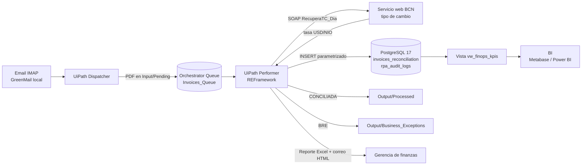

# Arquitectura de AutoFinOps-NI

Datos de demostración: proveedores, RUC y montos son ficticios.

## Flujo

## Componentes y puertos

| Componente | Imagen o herramienta | Puerto local | Contenedor |
|---|---|---|---|
| PostgreSQL 17 | `postgres:17-alpine` | 5432 | `autofinops_postgres` |
| pgAdmin 4 | `dpage/pgadmin4:latest` | 5050 | `autofinops_pgadmin` |
| Metabase | `metabase/metabase:latest` | 3001 | `autofinops_metabase` |
| Buzón de prueba IMAP/SMTP | `greenmail/standalone:2.1.15` | 3143 / 3025 | `autofinops_mail` |
| Robot | UiPath Studio 26 + Orchestrator | No aplica | No aplica |
| Tipo de cambio | `https://servicios.bcn.gob.ni/Tc_Servicio/ServicioTC.asmx` | 443 | No aplica |

## Datos

- `providers`: catálogo de proveedores autorizados y centro de costo.
- `invoices_reconciliation`: una fila por factura. Estados `CONCILIADA`, `OBSERVADA_REGLA_NEGOCIO`, `RECHAZADA_DUPLICADA`.
- `rpa_audit_logs`: una fila por ítem de cola (RNF-04).
- `vw_finops_kpis`: KPIs para el tablero.

Las credenciales viven en `infra/.env` y en Orchestrator Assets. Nunca en `.xaml` ni en `uipath_workflow/Data/Config.json`.
